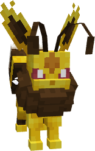
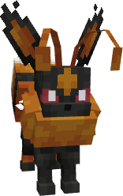

---
layout:
  width: wide
  title:
    visible: true
  description:
    visible: false
  tableOfContents:
    visible: true
  outline:
    visible: true
  pagination:
    visible: true
  metadata:
    visible: true
  tags:
    visible: true
  actions:
    visible: true
  anchors:
    visible: true
---

# #2029 - Draconeon


{% column width="50%" %}
<a href="./" class="button secondary small">&#x3C;—––</a>

Zobacz jak wygląda (Spoiler)

<figure><figcaption></figcaption></figure>

SHINY!! (Spoiler)

<figure><figcaption></figcaption></figure>



{% column width="50.000000000000014%" %}
***

<mark style="color:$info;">Gatunek</mark> Pokémon Smok

***

<mark style="color:$info;">Waga</mark> 24.5 kg (54.0 lbs)

***

<mark style="color:$info;">Type</mark>  Dragon

***

<mark style="color:$info;">Abilities</mark> Marvel Scale\
&#x20;             Draconize <mark style="color:$info;">(Hidden Ability)</mark>

***

<mark style="color:$info;">Local №</mark> #0029

***

<mark style="color:$info;">Spawn</mark> Peeks\* - Rare

***



### **Bazowe statystyki**

***


{% column width="16.666666666666664%" %}

<mark style="color:$info;">HP</mark>



{% column width="8.333333333333334%" %}
95


{% column width="75%" %}
▮▮▮▮▮▮▮▮▮▮



***


{% column width="16.666666666666664%" %}

<mark style="color:$info;">Attack</mark>



{% column width="8.333333333333334%" %}
110


{% column width="75%" %}
▮▮▮▮▮▮▮▮▮▮▮



***


{% column width="16.666666666666664%" %}

<mark style="color:$info;">Defence</mark>



{% column width="8.333333333333334%" %}
130


{% column width="75%" %}
▮▮▮▮▮▮▮▮▮▮▮▮▮



***


{% column width="16.666666666666664%" %}

<mark style="color:$info;">Sp. Atk</mark>



{% column width="8.333333333333334%" %}
65


{% column width="75%" %}
▮▮▮▮▮▮▮



***


{% column width="16.666666666666664%" %}

<mark style="color:$info;">Sp. Def</mark>



{% column width="8.333333333333334%" %}
65


{% column width="75%" %}
▮▮▮▮▮▮▮



***


{% column width="16.666666666666664%" %}

<mark style="color:$info;">Speed</mark>



{% column width="8.333333333333334%" %}
60


{% column width="75%" %}
▮▮▮▮▮▮



***


{% column width="16.666666666666664%" %}

<mark style="color:$info;">Total</mark>



{% column width="16.666666666666664%" %}
**525**


{% column width="66.66666666666667%" %}




### **Odporności na inne typy**

<mark style="color:$info;">Efektywność każdego typu na Draconeon'a<mark style="color:$info;">

<table data-header-hidden><thead><tr><th width="80" align="center"></th><th width="80" align="center"></th><th width="80" align="center"></th><th width="80" align="center"></th><th width="80" align="center"></th><th width="80" align="center"></th><th width="80" align="center"></th><th width="80" align="center"></th><th width="80" align="center"></th></tr></thead><tbody><tr><td align="center"></td><td align="center"></td><td align="center"></td><td align="center"></td><td align="center"></td><td align="center"></td><td align="center"></td><td align="center"></td><td align="center"></td></tr><tr><td align="center"></td><td align="center"><mark style="color:$warning;">½</mark></td><td align="center"><mark style="color:$warning;">½</mark></td><td align="center"><mark style="color:$warning;">½</mark></td><td align="center"><mark style="color:$warning;">½</mark></td><td align="center"><mark style="color:$success;">2</mark></td><td align="center"></td><td align="center"></td><td align="center"></td></tr><tr><td align="center"></td><td align="center"></td><td align="center"></td><td align="center"></td><td align="center"></td><td align="center"></td><td align="center"></td><td align="center"></td><td align="center"></td></tr><tr><td align="center"></td><td align="center"></td><td align="center"></td><td align="center"></td><td align="center"></td><td align="center"><mark style="color:$success;">2</mark></td><td align="center"></td><td align="center"></td><td align="center"><mark style="color:$success;">2</mark></td></tr></tbody></table>

### **Drzewko ewolucyjne**

<h4 align="center">  <a href="https://pokemondb.net/pokedex/eevee">Eevee</a>        —>        <a href="2029-draconeon.md">Draconeon</a>       (use Dragon Fang)     </h4>



### **Trening**

<mark style="color:$info;">EV Yield</mark> 2 Defence

<mark style="color:$info;">Catch Rate</mark> 45 <mark style="color:$info;">(5.9% with Pokeball, Full HP)</mark>



### **Breeding**

<mark style="color:$info;">Egg Groups</mark> Field

<mark style="color:$info;">Gender</mark> <mark style="color:blue;">87.5% male</mark>, <mark style="color:pink;">12.5% female</mark>



<h3 align="center"><strong>Ruchy Draconeon'a</strong></h3>



#### Uczone poprzez Ewolucje

 Dragon Breath

#### Uczone poprzez Level-Up

<mark style="color:$info;">1</mark>   Baton Pass\
<mark style="color:$info;">1</mark>   Charm\
<mark style="color:$info;">1</mark>   Copycat\
<mark style="color:$info;">1</mark>   Covet\
<mark style="color:$info;">1</mark>   Double-Edge\
<mark style="color:$info;">1</mark>   Growl\
<mark style="color:$info;">1</mark>   Helping Hand\
<mark style="color:$info;">1</mark>   Tackle\
<mark style="color:$info;">1</mark>   Tailwhip\
<mark style="color:$info;">1</mark>   Take Down\
<mark style="color:$info;">5</mark>   Sand Attack\
<mark style="color:$info;">10</mark>  Quick Attack\
<mark style="color:$info;">15</mark>   Baby-Doll Eyes\
<mark style="color:$info;">20</mark>   Swift\
<mark style="color:$info;">25</mark>   Breaking Swipe\
<mark style="color:$info;">30</mark>   Roost\
<mark style="color:$info;">35</mark>   Crunch\
<mark style="color:$info;">40</mark>   Dragon Tail\
<mark style="color:$info;">45</mark>   Dragon Dance\
<mark style="color:$info;">50</mark>   Outrage\
<mark style="color:$info;">55</mark>   Last Resort



#### Uczone poprzez TM

 Alluring Voice\
 Baton Pass\
 Body Slam\
 Breaking Swipe\
 Bulk Up\
 Calm Mind\
 Charm\
 Crunch\
 Curse\
 Dig\
 Double-Edge\
 Draco Meteor\
 Dragon Claw\
 Dragon Dance\
 Dragon Pulse\
 Dragon Tail\
Earthquake\
 Endure\
 Facade\
 Fake Tears\
 Helping Hand\
 Hyper Voice\
 Iron Head\
 Zen Headbutt\
 Mud-Slap\
 Outrage\
 Protect\
 Rain Dance\
 Rest\
 Roar\
 Rock Slide\
 Scale Shot\
 Shadow Ball\
 Sleep Talk\
 Stored Power\
 Stone Edge\
 Substitute\
 Sunny Day\
 Swift\
 Take Down\
 Tera Blast\
 Trailblaze\
 Weather Ball


