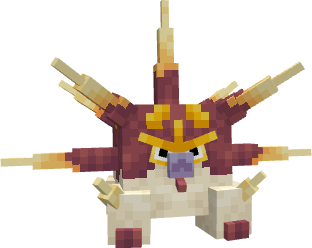
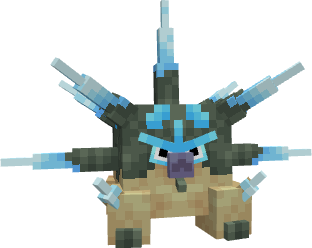

---
layout:
  width: wide
  title:
    visible: true
  description:
    visible: false
  tableOfContents:
    visible: true
  outline:
    visible: true
  pagination:
    visible: true
  metadata:
    visible: true
  tags:
    visible: true
  actions:
    visible: true
  anchors:
    visible: true
---

# #2040 - Oloriański Duosion


{% column width="50%" %}
<a href="./" class="button secondary small">&#x3C;—––</a>

Zobacz jak wygląda (Spoiler)

<figure><figcaption></figcaption></figure>

SHINY!! (Spoiler)

<figure><figcaption></figcaption></figure>



{% column width="50.000000000000014%" %}
***

<mark style="color:$info;">Gatunek</mark> Pokémon Mitoza

***

<mark style="color:$info;">Waga</mark> 8.0 kg (17.6 lbs)

***

<mark style="color:$info;">Type</mark>  Water /  Psychic

***

<mark style="color:$info;">Abilities</mark> [Water Absorb](#user-content-fn-1)[^1]\
&#x20;             Regenerator[^2]\
&#x20;             Mindwash[^3] <mark style="color:$info;">(Hidden Ability)</mark>

***

<mark style="color:$info;">Local №</mark> #0040

***

<mark style="color:$info;">Spawn</mark> Ocean\* - Uncommon

***



### **Bazowe statystyki**

***


{% column width="16.666666666666664%" %}

<mark style="color:$info;">HP</mark>



{% column width="8.333333333333334%" %}
90


{% column width="75%" %}
▮▮▮▮▮▮▮▮▮



***


{% column width="16.666666666666664%" %}

<mark style="color:$info;">Attack</mark>



{% column width="8.333333333333334%" %}
40


{% column width="75%" %}
▮▮▮▮



***


{% column width="16.666666666666664%" %}

<mark style="color:$info;">Defence</mark>



{% column width="8.333333333333334%" %}
50


{% column width="75%" %}
▮▮▮▮▮



***


{% column width="16.666666666666664%" %}

<mark style="color:$info;">Sp. Atk</mark>



{% column width="8.333333333333334%" %}
110


{% column width="75%" %}
▮▮▮▮▮▮▮▮▮▮▮



***


{% column width="16.666666666666664%" %}

<mark style="color:$info;">Sp. Def</mark>



{% column width="8.333333333333334%" %}
50


{% column width="75%" %}
▮▮▮▮▮



***


{% column width="16.666666666666664%" %}

<mark style="color:$info;">Speed</mark>



{% column width="8.333333333333334%" %}
30


{% column width="75%" %}
▮▮▮



***


{% column width="16.666666666666664%" %}

<mark style="color:$info;">Total</mark>



{% column width="16.666666666666664%" %}
**370**


{% column width="66.66666666666667%" %}




### **Odporności na inne typy**

<mark style="color:$info;">Efektywność każdego typu na Duosion'a<mark style="color:$info;">

<table data-header-hidden><thead><tr><th width="80" align="center"></th><th width="80" align="center"></th><th width="80" align="center"></th><th width="80" align="center"></th><th width="80" align="center"></th><th width="80" align="center"></th><th width="80" align="center"></th><th width="80" align="center"></th><th width="80" align="center"></th></tr></thead><tbody><tr><td align="center"></td><td align="center"></td><td align="center"></td><td align="center"></td><td align="center"></td><td align="center"></td><td align="center"></td><td align="center"></td><td align="center"></td></tr><tr><td align="center"></td><td align="center"><mark style="color:$warning;">½</mark></td><td align="center"><mark style="color:$warning;">½</mark></td><td align="center"><mark style="color:$success;">2</mark></td><td align="center"><mark style="color:$success;">2</mark></td><td align="center"><mark style="color:$warning;">½</mark></td><td align="center"><mark style="color:$warning;">½</mark></td><td align="center"></td><td align="center"></td></tr><tr><td align="center"></td><td align="center"></td><td align="center"></td><td align="center"></td><td align="center"></td><td align="center"></td><td align="center"></td><td align="center"></td><td align="center"></td></tr><tr><td align="center"></td><td align="center"><mark style="color:$warning;">½</mark></td><td align="center"><mark style="color:$success;">2</mark></td><td align="center"></td><td align="center"><mark style="color:$success;">2</mark></td><td align="center"></td><td align="center"><mark style="color:$success;">2</mark></td><td align="center"><mark style="color:$warning;">½</mark></td><td align="center"><mark style="color:$warning;">½</mark></td></tr></tbody></table>

### **Drzewko ewolucyjne**

<h4 align="center"><a href="2039-olorianski-solosis.md">Solosis</a>     —>     <a href="2040-olorianski-duosion.md">Duosion</a>     —>     <a href="2041-olorianski-reuniclus.md">Reuniclus</a>       (Level 32)              (Level 41)            </h4>



### **Trening**

<mark style="color:$info;">EV Yield</mark> 2 Sp. Atk

<mark style="color:$info;">Catch Rate</mark> 100 <mark style="color:$info;">(13.1% with Pokeball, Full HP)</mark>



### **Breeding**

<mark style="color:$info;">Egg Groups</mark> Amorphous

<mark style="color:$info;">Gender</mark> <mark style="color:blue;">50% male</mark>, <mark style="color:pink;">50% female</mark>



<h3 align="center"><strong>Ruchy Duosion'a</strong></h3>


{% column width="50%" %}
#### Uczone poprzez Level-Up

<mark style="color:$info;">1</mark>   Confusion\
<mark style="color:$info;">1</mark>   Endeavor\
<mark style="color:$info;">1</mark>   Heal Block\
<mark style="color:$info;">1</mark>   Protect\
<mark style="color:$info;">1</mark>   Psywave\
<mark style="color:$info;">1</mark>   Recover\
<mark style="color:$info;">1</mark>   Snatch\
<mark style="color:$info;">12</mark>  Water Gun\
<mark style="color:$info;">16</mark>   Charm\
<mark style="color:$info;">20</mark>   Psyshock\
<mark style="color:$info;">24</mark>  Light Screen\
<mark style="color:$info;">24</mark>   Reflect\
<mark style="color:$info;">28</mark>   Aqua Ring\
<mark style="color:$info;">35</mark>  Pain Split\
<mark style="color:$info;">40</mark>   Psychic\
<mark style="color:$info;">46</mark>   Skill Swap\
<mark style="color:$info;">52</mark>   Hydro Pump\
<mark style="color:$info;">58</mark>   Wonder Room

#### Uczone poprzez Breeding

 Acid Armor\
 Astonish\
 Confuse Ray\
 Heal Block\
 Secret Power


{% column width="49.999999999999986%" %}
#### Uczone poprzez TM

 Body Slam\
 Calm Mind\
 Charm\
 Chilling Water\
 Confuse Ray\
 Endure\
 Endeavor\
 Energy Ball\
 Encore\
 Expanding Force\
 Facade\
 Flash Cannon\
 Fling\
 Focus Blast\
 Future Sight\
 Giga Impact\
 Grass Knot\
 Gravity\
 Gyro Ball\
 Helping Hand\
 Hydro Pump\
 Hyper Beam\
 Imprison\
 Iron Defense\
 Knock Off\
 Light Screen\
 Night Shade\
 Pain Split\
 Protect\
 Psybeam\
 Psychic\
 Psychic Noise\
 Psychic Terrain\
 Psych Up\
 Psyshock\
 Rain Dance\
 Reflect\
 Rest\
 Rock Slide\
 Rock Tomb\
 Scald\
 Shadow Ball\
 Skill Swap\
 Sleep Talk\
 Stored Power\
 Substitute\
 Sunny Day\
 Surf\
 Swift\
 Tera Blast\
 Thunder\
 Thunder Wave\
 Trick\
 Trick Room\
 Water Pulse\
 Wrap\
 Zen Headbutt



[^1]: Pokémon z umiejętnością _Water Absorb_ odnawia ¼ jego maksymalnego HP po zostaniu uderzonym przez Water-type atak.

[^2]: Pokémon z umiejętnością _Regenerator_ odnawia ⅓ jego maksymalnego HP po zmianie podczasz walki.

[^3]: _Mindwash_ ma 30% na wywołanie confusion kiedy Pokémon uderzy przewnika Water-type ruchem.
